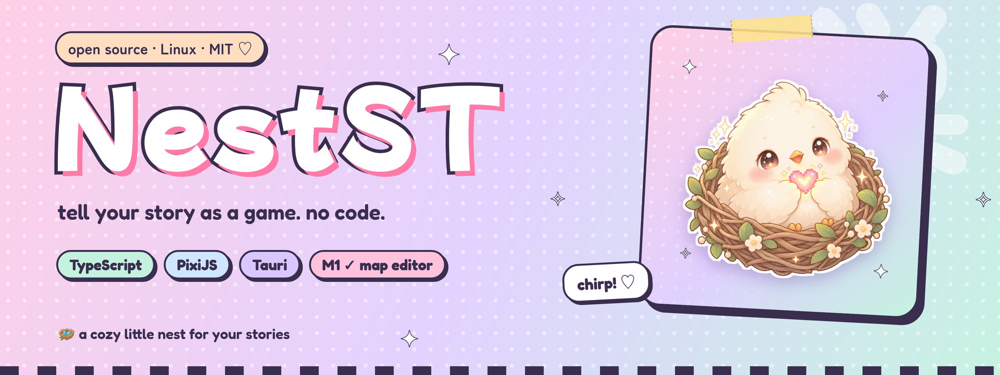
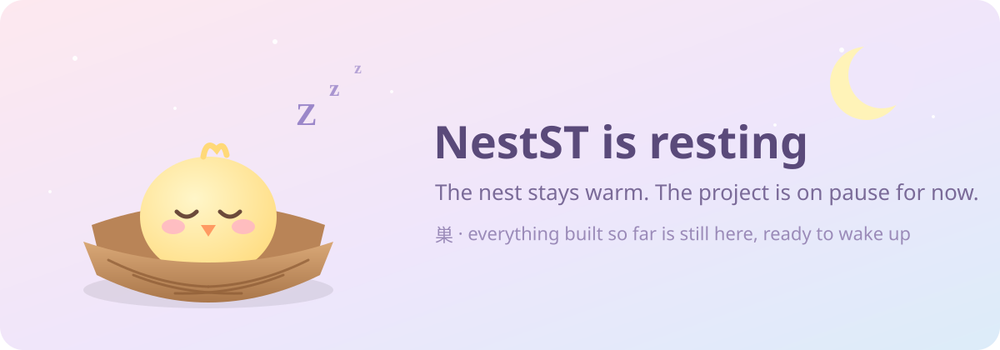
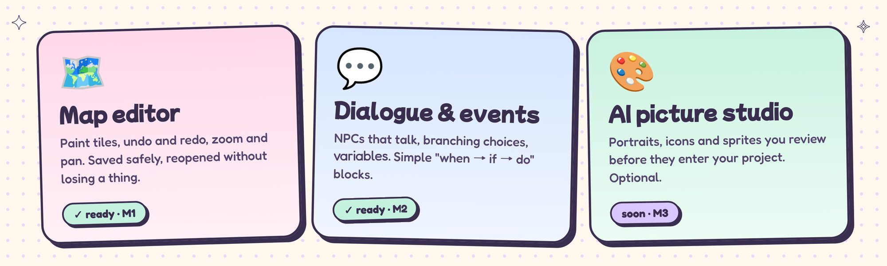
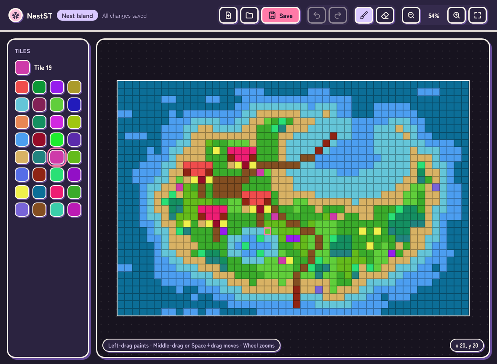

<div align="center">




**A lightweight, open-source 2D game maker for Linux, so anyone can tell their story as a game. No programming required.**

</div>

<div align="center">



</div>

> 🪺 **On pause, honestly.** NestST is on hold for an indefinite time. Nothing is broken or abandoned in a messy way: everything built so far (the editor, Play preview, branching dialogue, events and a first-steps guide for newcomers) works and stays here as it was left. Real graphics and the AI studio were the next steps and have not been started. Issues and pull requests may wait a long time for an answer. If you want to take it further, you are very welcome to fork it (MIT).

## ♡ The idea

NestST is for people who have a story but don't want to write code: storytellers, writers, hobbyists, fans of manga and anime. You draw maps, place characters, write branching dialogue and set up events in friendly visual editors. The engine handles the rest.

<div align="center">



</div>

- **Visual map editor:** tiles, walls and water you can't walk through, characters, a start point, undo/redo.
- **Dialogue and events without code:** branching dialogue in a node editor, variables, and simple "event → condition → action" blocks (start a dialogue, change a variable, teleport to another map). Quests are planned.
- **Play button:** walk around your map right inside the editor and talk to your characters.
- **A first-steps guide:** a small checklist in the editor walks a newcomer from an empty map to a playable scene, and the start screen can open a finished example.
- **AI image studio:** portraits, icons and sprites, reviewed by you before they enter the project. Opt-in, bring your own key. The editor and your games work fine without AI.
- **Lightweight:** a native Linux app (Tauri); games can run in the browser too.
- **Open:** MIT license, a versioned project format with safe migrations. Your games belong to you.

The first template is a top-down JRPG. Other game modes (for example a side view) are planned.

## ✦ What it looks like today

<div align="center">



<sub>*Nest Island*, a tiny example map made with the editor itself. Open the folder [`examples/nest-island`](examples/nest-island) to explore it (it has a talking guide and a cave).</sub>

</div>

### 🐈 A small game to play: Lost Cat

[`examples/lost-cat`](examples/lost-cat) is a complete tiny quest made with the editor: Mira lost her cat, so you walk to the garden, find Mochi and bring her home for a reward. It shows a two-map game with variables, a branching dialogue, signs and gate teleports. Open the folder in the editor, press **Play**, and read its [README](examples/lost-cat/README.md) for a short tour of how it is built.

<div align="center">

</div>

## 🌸 Try the editor

Requirements: Rust, Node.js 24+, pnpm, `webkit2gtk-4.1`, `gtk3` (Linux only).

```bash
pnpm install
pnpm -F @nestst/editor tauri dev                 # development mode
pnpm -F @nestst/editor tauri build --no-bundle   # release binary: apps/editor/src-tauri/target/release/nestst_editor
```

What you can do right now:

- **Follow the first-steps panel** on the Map tab: draw some ground, place the start point, add a character, write them a line, press Play. Or press **Try an example** on the start screen to open the finished Lost Cat game in a folder of your own.
- **Create a project** in a folder you pick, or **open** an existing one (older projects are upgraded automatically, and the old files are backed up first).
- **Paint tiles** with the brush and the eraser (32 built-in coloured tiles for now; your own images come later). Mark a tile **Can't walk through** to make walls and water.
- **Place objects:** a **Start point** (P), **Characters** (N) and **Trigger tiles** (T); select one (V) to edit its name, dialogue, trigger, condition and actions.
- **Variables** tab: flags and numbers your story can remember. **Dialogs** tab: build branching dialogue as connected nodes (say, choice, set variable, branch).
- **Play** (F5): walk with the arrow keys or WASD, talk with Space / Enter / Z, stop with Esc.
- **Undo / redo** (Ctrl+Z, Ctrl+Shift+Z or Ctrl+Y), **save** (Ctrl+S). Shortcuts also work on a Russian keyboard layout.
- **Zoom** with the mouse wheel (50 %–800 %), **pan** with the middle mouse button or Space + drag.
- Light and dark themes. Close the window with unsaved changes and the editor asks first.

A project is a plain folder: `nestst.project.json`, one JSON file per map in `maps/` and one per dialogue in `dialogs/`. Files are written safely (temp file, then rename), and the app can only touch folders you picked in its dialog.

Not there yet: images instead of coloured shapes, quests, items and inventory, sound, more than one layer in the UI, Windows. The graphics and the dialogue box are placeholders for now.

## 🗺 Roadmap

| Milestone | What | State |
|---|---|---|
| M0 | Risk prototype: Tauri + PixiJS + node editor, measurements | ✅ done ([report](docs/m0-report.md)) |
| M1 | Project core, versioned format, map rendering, map editor with undo/redo | ✅ done and hands-on checked ([report](docs/m1-report.md)) |
| M2 | Player and NPCs, Play preview, events, branching dialogue, variables, teleports, two example games | ✅ done |
| M2.5 | UX and onboarding: first-steps panel, friendlier names, clear empty screens, a one-click example | ✅ built, not yet hands-on checked |
| M3 | AI studio: generate, review, import | 💤 paused |
| M4 | Items, inventory, JRPG template, export | 💤 paused |

More: [research](docs/research.md), [M0 report](docs/m0-report.md), [M1 report](docs/m1-report.md). *(The in-depth docs are currently written in Russian; they will be translated as the project matures.)*

## 🛠 Tech

TypeScript, [PixiJS](https://pixijs.com) for rendering, [Tauri 2](https://tauri.app) for the Linux shell, React, zod, vitest, pnpm. Tauri was chosen from prototype measurements ([M0 report](docs/m0-report.md)); we measured Electron too: smoother minimum FPS, but much heavier on memory and disk.

Run all tests: `pnpm -r test` (and `cargo test` in `apps/editor/src-tauri`).

<details>
<summary>Run the M0 prototype</summary>

Requirements: Rust, Node.js 24+, pnpm, `webkit2gtk-4.1`, `gtk3`.

```bash
pnpm install
cd prototypes/m0
pnpm tauri dev                 # development mode
pnpm tauri build --no-bundle   # release binary: src-tauri/target/release/m0
```

In the window: **M** toggles the map size (200↔1000), **G** switches between the map and the dialogue graph.

</details>

## 🤝 Contributing

The project is on pause (see the top of this page), so replies may take a long time. Ideas and forks are still welcome. See [CONTRIBUTING.md](CONTRIBUTING.md) and the [issue templates](.github/ISSUE_TEMPLATE).

## License

[MIT](LICENSE). Your games belong to you. ✦ *Illustrations in this README are original and AI-assisted.*
